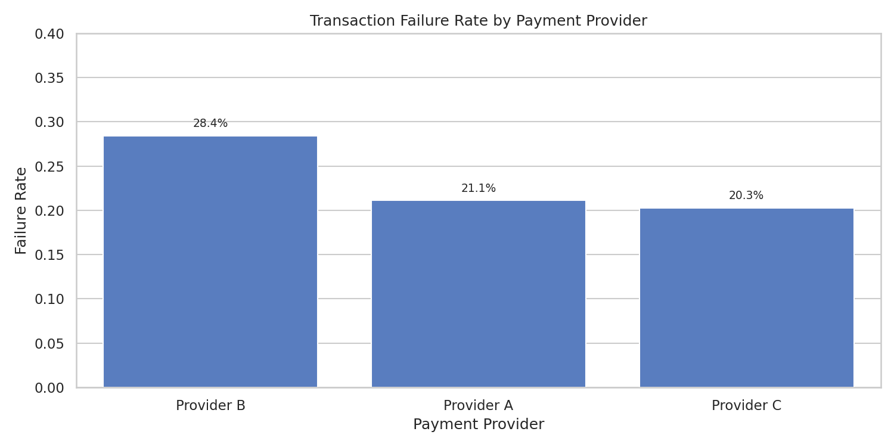
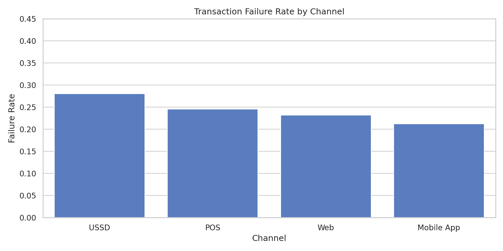
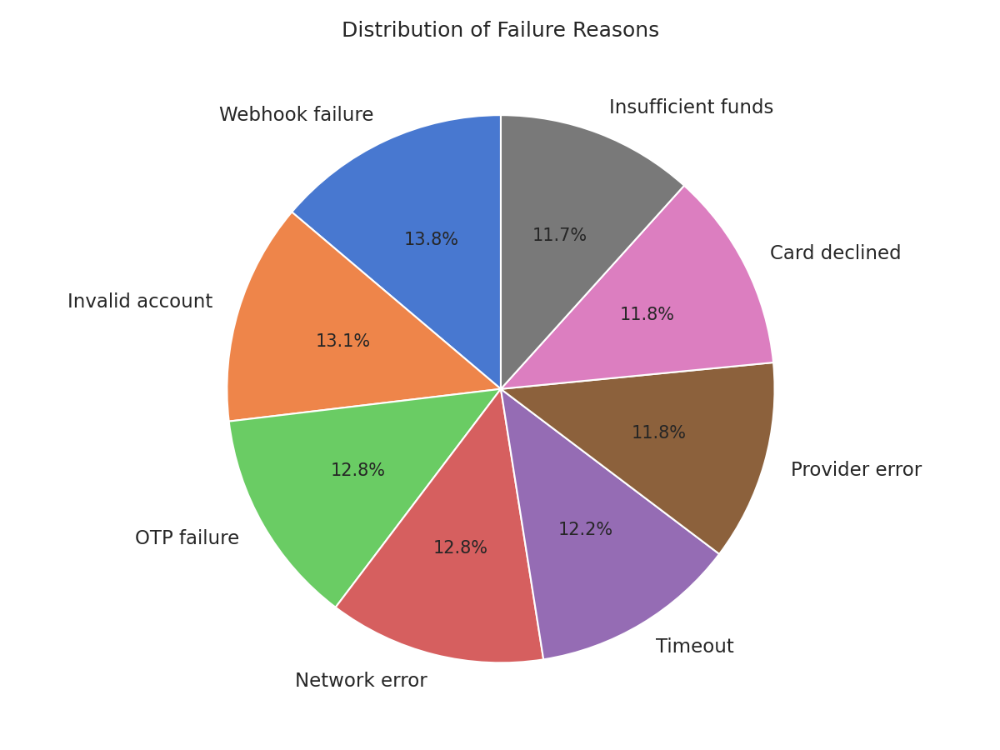
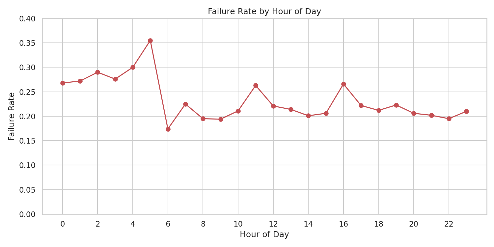
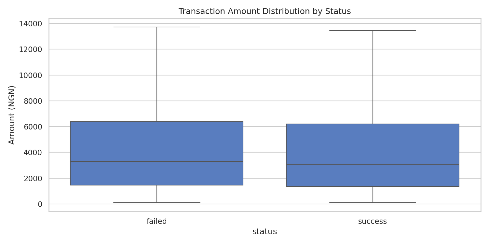

# Transaction Failure Root-Cause Dashboard

**Author:** [Omololu Oyewumi](https://www.linkedin.com/in/omololu-oyewumi-4aa682331)  
**Stack:** Python · Pandas · Matplotlib · Seaborn

---

## Problem Statement

In payment platforms, every failed transaction is a lost conversion, a support ticket, and a hit to customer trust. Support teams often treat failures one-by-one, but the real leverage comes from understanding *patterns*: which providers fail more, which channels are fragile, and at what times of day problems spike.  

This project answers that question with a structured root-cause analysis of synthetic transaction data modelled on common Nigerian fintech flows (Provider A, Provider B, Provider C style). The goal is to turn raw failure logs into clear, actionable insights for operations and product teams.

**No real customer or company data was used.** All data is synthetic.

---

## Overview

- **8,000** synthetic transactions over ~90 days  
- Overall failure rate: **23.3%**  
- Dimensions analysed: payment provider, channel, hour of day, failure reason, amount

---

## Key Findings

| Dimension | Insight |
|-----------|---------|
| **Provider** | Provider B has the highest failure rate (**28.4%**) vs Provider A (21.1%) and Provider C (20.3%) |
| **Channel** | USSD fails most often (**28.1%**), followed by POS |
| **Time** | Early morning hours (00:00–05:00) show clearly elevated failure rates |
| **Reasons** | Webhook failure, Invalid account, OTP failure, Network error and Timeout dominate |

### Failure Rate by Provider


### Failure Rate by Channel


### Distribution of Failure Reasons


### Failure Rate by Hour of Day


### Transaction Amount by Status


---

## Business Implications

- Preferential routing or failover rules away from higher-failure providers during risk windows  
- Review USSD session handling and timeout settings  
- Adjust monitoring coverage for early-morning hours  
- Consider extra confirmation steps for high-value transactions  

---

## How to Run the Dashboard

```bash
# Install dependencies
pip install -r ../requirements.txt

# Launch the interactive dashboard
streamlit run app.py
```

The dashboard opens in your browser with KPIs, filters and interactive charts on one page.

### Optional: Regenerate data / static charts
```bash
python scripts/generate_data.py
python scripts/analyze.py
```


## Tech Stack

Python, Pandas, NumPy, Matplotlib, Seaborn, Faker

## Project Structure
```
├── app.py                          ← Streamlit dashboard (main entry)
├── data/
│   └── transaction_failures.csv
├── scripts/
│   ├── generate_data.py
│   └── analyze.py
├── outputs/                        ← static charts (optional)
│   ├── failure_rate_by_provider.png
│   ├── failure_rate_by_channel.png
│   ├── failure_reasons.png
│   ├── failure_rate_by_hour.png
│   ├── amount_by_status.png
│   └── insights_summary.txt
└── README.md
```

---

## Disclaimer

**Important:** All figures are from synthetic data generated to demonstrate analytical methodology and dashboard design. They do **not** represent real-world performance of any payment provider or platform.

Provider names are fictional (Provider A / B / C). No real payment provider performance is implied. Patterns were parameterized to fall within realistic operational ranges for illustration purposes only.

---

**Connect with me:** [LinkedIn](https://www.linkedin.com/in/omololu-oyewumi-4aa682331)
